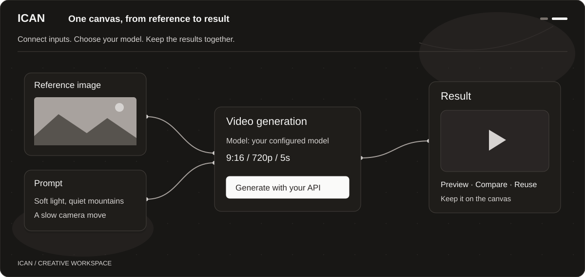
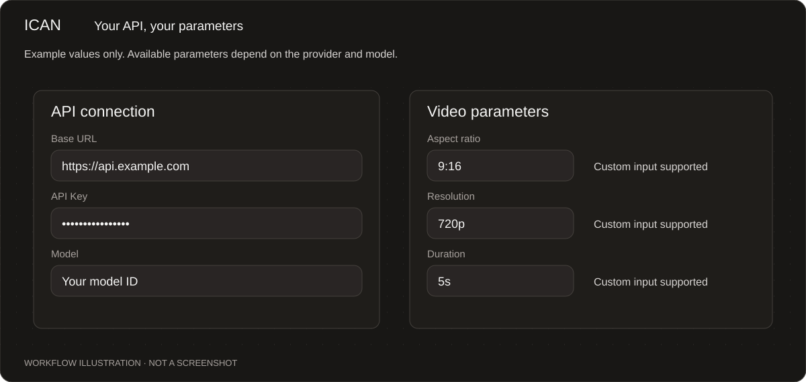
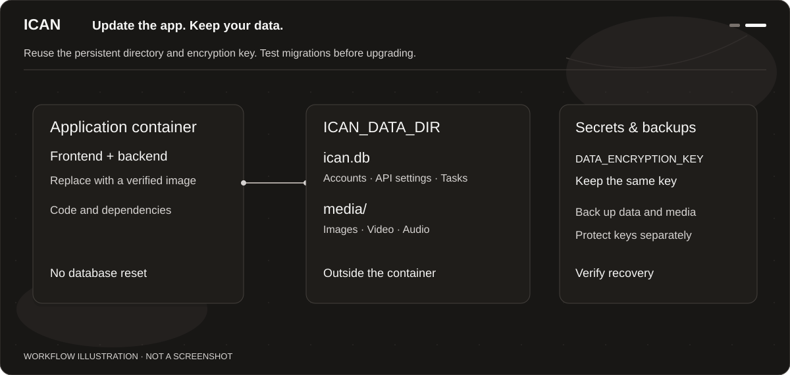

# ICAN

**English** · [简体中文](README.zh-CN.md)

**Bring your own API. Keep your references, ideas, and results on one canvas.**

ICAN is a self-hosted AI creative workspace derived from [Infinite Canvas](https://github.com/basketikun/infinite-canvas), using [tigerowo’s derivative](https://github.com/tigerowo/infinite-canvas) as its direct code base. It brings prompts, reference material, and image and video generation together for individuals and small teams who want to manage their own projects and media.

Models run through the external APIs you configure. The canvas itself does not need a GPU. ICAN includes no model credits or preset paid channels; usage costs depend on your provider.



*Illustrations follow the application's canvas theme. They explain workflows and are not screenshots.*

## What you can do

- **Work on a canvas.** Arrange references, prompts, and results side by side. Connect nodes to reuse inputs and compare outputs, with zoom, selection, undo/redo, and project import/export.
- **Custom templates for model APIs and API gateways.** Users can set their API URL, key, and models; administrators can maintain shared channels. Custom templates configure request parameters and response parsing. Services using a supported protocol can be configured directly; other protocols may need an adapter.
- **Control generation parameters.** Video aspect ratio, resolution, and duration support presets and custom values, with image, video, and audio references. Supported values depend on the API.
- **Continue on another device.** Signed-in users can recover synced canvases, settings, media, and records. Existing tasks support status checks and recovery. Guest data stays in the current browser.
- **Keep media in one place.** The server manages media storage, so users do not need their own WebDAV setup. Private files require account access; providers receive separate authorized reference links.



## What changed in this fork

ICAN keeps the original canvas, accounts, settings sync, and media management, with a smaller feature scope and additional security controls.

| Change | What it means |
|---|---|
| Custom APIs first | Removed preset paid channels and models, advertising, promotional and tutorial entries, fixed third-party media uploads, and remote subscription paths |
| Invitation-only registration | Administrators issue invitations; sessions can be revoked on logout, password changes, or account disablement |
| No silent substitutions | Invalid models or channels return errors instead of switching the model, URL, or key; custom video parameters retain their values |
| Private media and sensitive settings | Server-side sensitive settings are encrypted; media ownership is checked, active content such as HTML and SVG is rejected, and provider links can be revoked |
| Restricted server requests | Outbound addresses, DNS resolution, and redirects are checked to restrict loopback, private-network, and cloud metadata access |
| Smaller enabled feature set | Director, Agent/Bridge, ComfyUI, RunningHub/AutoDL workflows, OAuth, and credit billing are disabled in this iteration, with backend enforcement |
| Docker deployment | Non-root execution, a read-only root filesystem, and reduced privileges; pinned dependencies and base images, with fewer unnecessary runtime components |

Personal API settings are also used in the browser, and some requests go directly from the browser to the provider. Server-side encryption does not hide keys from the client. Your configured model provider receives the prompts and references needed for generation.

## Try it with Docker

**This is a development preview. Start in a separate test environment.** The Docker candidate has passed build, container/Compose, and automated checks. Remaining work is listed below.

The current Docker setup lives on [`security/runtime-isolation-candidate`](https://github.com/ruoyeyu/ICAN/tree/security/runtime-isolation-candidate) and has not been merged into `main`. The tested platform is Linux / amd64. Docker and Docker Compose are required.

```sh
git clone https://github.com/ruoyeyu/ICAN.git
cd ICAN
git switch security/runtime-isolation-candidate
cp .env.example .env
chmod 600 .env
```

Set administrator credentials, separate secrets, your public URL, the persistent data directory, and runtime limits. There is no default administrator password or universal set of production limits.

No ready-to-pull ICAN image has been published. Follow the [Docker operations guide](https://github.com/ruoyeyu/ICAN/blob/security/runtime-isolation-candidate/docs/security/docker-operations.md) to build and verify an image and set `ICAN_IMAGE`. Compose uses an already loaded, fixed image rather than automatically tracking the latest release.

### Keep your data when updating



The database and media live outside the container through the `ICAN_DATA_DIR` mount. Reusing that directory and the encryption key lets a replacement container read accounts, canvases, saved personal API settings, and administrator channels.

Routine updates must not reinitialize the database or regenerate `DATA_ENCRYPTION_KEY`. Schema or configuration format changes need migration and recovery testing. **A complete versioned migration system is still pending; replacing the image alone does not guarantee compatibility across versions.** Back up the database, media, and keys.

## Current status

- Canvas and custom API cleanup, account/media access controls, dependency updates, and automated Docker verification are in place.
- Production resource and network boundaries, real-browser and provider acceptance, and legacy/cross-version migration drills remain open. Live custom API contracts and historical tasks still require acceptance testing; universal provider compatibility is not claimed.

Security scope, evidence, and outstanding work are recorded in the repository. A scan covers a particular code and image snapshot; it does not replace deployment acceptance.

- [Security changes and verification](docs/security/hardening-review.md)
- [Runtime dependencies, binaries, and external references](docs/security/supply-chain-review.md)
- [Docker candidate CI run](https://github.com/ruoyeyu/ICAN/actions/runs/40086299774)
- [Open work](https://github.com/ruoyeyu/ICAN/blob/security/runtime-isolation-candidate/docs/progress/todo.md)

Detailed engineering and operations documents are currently in Chinese.

## Development

The frontend uses Next.js, React, and TypeScript. The backend uses Go, Gin, and GORM. The current Docker setup uses SQLite and server-local media storage.

Build toolchains are pinned in the [Dockerfile](Dockerfile); dependency versions are recorded in `go.mod`, `go.sum`, and `web/bun.lock`. Run `go test ./...` from the repository root. In `web`, run:

```sh
bun install --frozen-lockfile --ignore-scripts
bun test src
bun run build
```

Reproducible bug reports and specific API adapter requests are welcome. Remove API keys, login credentials, and private media links before sharing logs or example requests.

## Credits and license

The original project is [basketikun/infinite-canvas](https://github.com/basketikun/infinite-canvas). ICAN uses [tigerowo/infinite-canvas](https://github.com/tigerowo/infinite-canvas) as its direct code base; that derivative credits the original project and incorporates the image-generation enhancements from [HuFakai/infinite-canvas](https://github.com/HuFakai/infinite-canvas). Thanks to the authors and contributors of all three projects.

ICAN retains the [AGPL-3.0](LICENSE) license of the adopted code base, along with original attribution and copyright notices; see [NOTICE](NOTICE).

This fork modifies the upstream UI and default integrations, adds invitation-only registration and session revocation, encrypts saved sensitive settings, enforces media ownership and controlled provider links, checks server outbound requests, updates dependencies, and adds container isolation and verification. See the [hardening review](docs/security/hardening-review.md) and [supply-chain review](docs/security/supply-chain-review.md) for evidence and limitations. These changes do not establish absolute security: production network/resource controls, live provider acceptance, and migration/backup recovery remain deployment gates.
