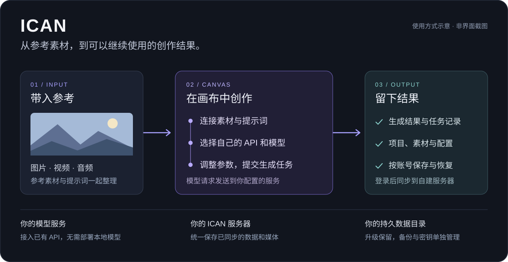
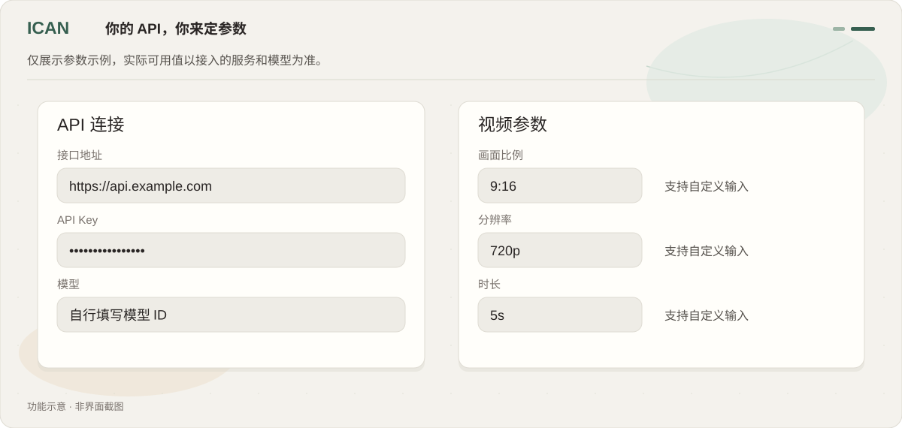
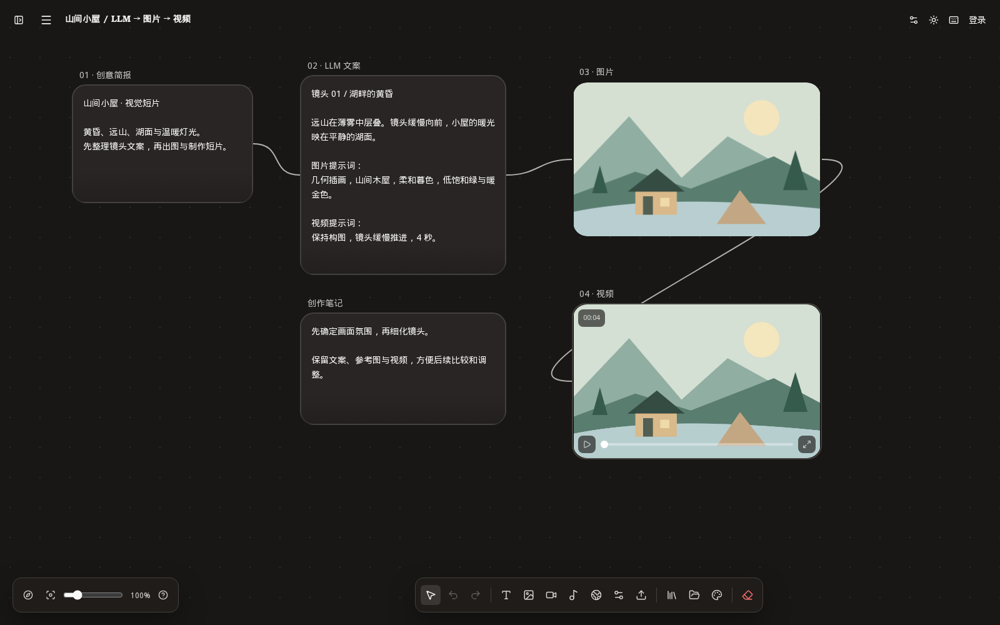
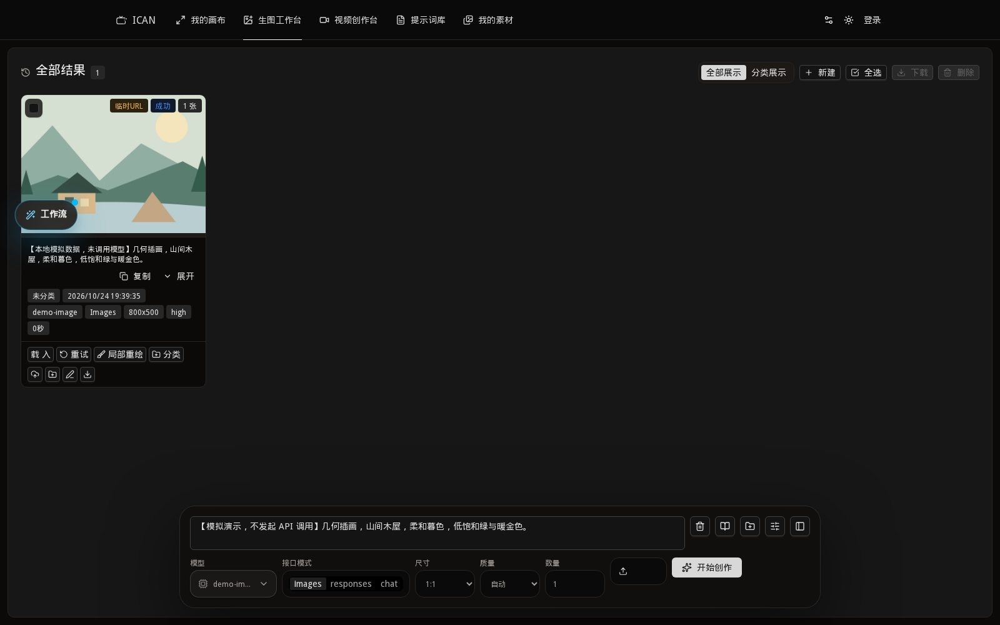
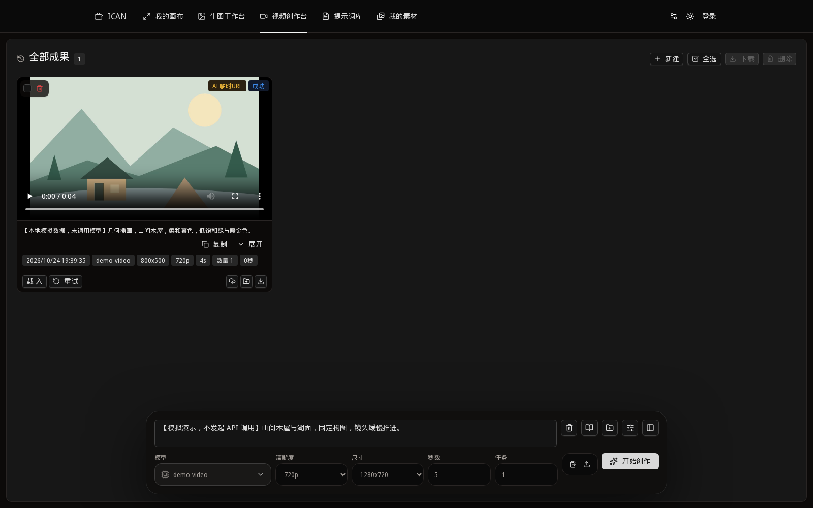
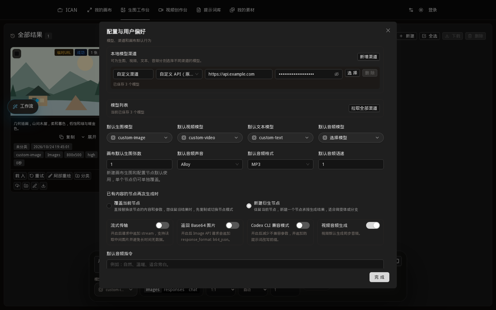
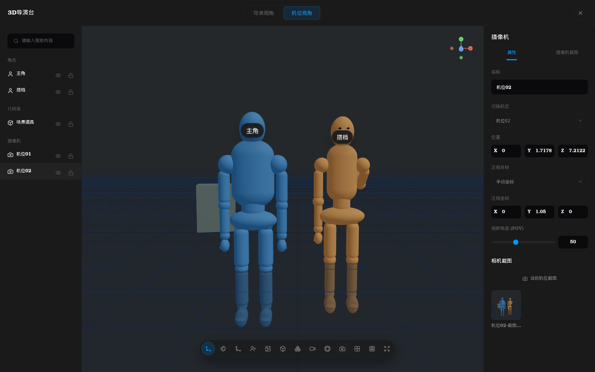
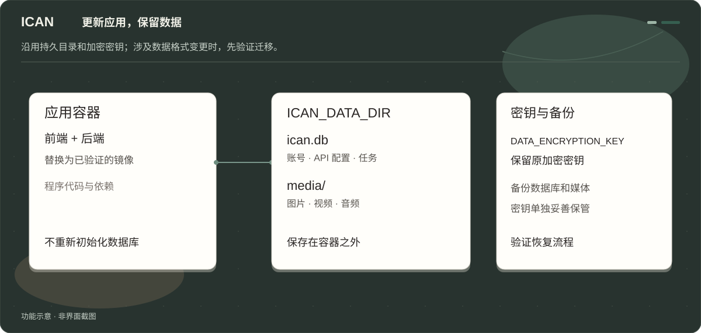

# ICAN

[English](README.md) · **简体中文**

**接自己的 API，在一张画布里整理参考、尝试想法、留下结果。**

ICAN 是一个可以自己部署的 AI 创作工作台，源自 [Infinite Canvas 原项目](https://github.com/basketikun/infinite-canvas)，以 [tigerowo 的二次开发版本](https://github.com/tigerowo/infinite-canvas) 为直接代码基础。它把提示词、参考素材和图片、视频生成放在一起，适合已经有模型 API、想自己管理项目和素材的个人或小团队。

模型通过你配置的外部 API 调用，运行画布本身不需要 GPU。项目不提供模型额度，也不预设付费渠道；调用费用由接入的服务决定。



*图示沿用网站画布主题，用于说明功能流程，并非界面截图。*

## 能用它做什么

- **在画布上组织创作。** 把参考图、提示词和生成结果摆在一起，通过节点连线复用输入、比较结果；支持缩放、框选、撤销重做及项目导入导出。
- **支持各类中转站与模型 API 自定义模板。** 用户可配置 API 地址、Key 和模型，管理员可维护统一渠道；通过自定义模板配置请求参数和响应解析。兼容已有协议的服务可直接配置，特殊协议可能需要额外适配。
- **调整图片与视频参数。** 视频比例、分辨率、时长支持选项和自定义输入，可使用图片、视频、音频参考。具体参数范围以接入的 API 为准。
- **换设备继续做。** 登录后，已同步的画布、个人配置、素材和记录随账号保存；已有任务支持状态查询和恢复。所有工作台均需登录，新账号需要邀请码。
- **统一保存素材。** 默认由服务器管理媒体，普通用户不用另搭 WebDAV。私人文件按账号访问，供应商需要读取参考素材时使用单独的授权链接。



## 界面预览

以下界面使用本地示例数据，文案与媒体并非真实模型生成，未调用付费 API。说明图统一沿用平台深色中性配色；英文文档中的界面文字仅为截图翻译，应用 UI 和语言功能未修改。

**画布：创意简报 → LLM 文案 → 图片 → 视频**



<details>
<summary>展开查看图片工作台、视频工作台和 API 配置</summary>

**图片工作台：结果与生成设置**



**视频工作台：视频与生成设置**



**API 配置：示例地址与占位凭据**



</details>

**3D 导演台 — 场景构图、机位控制与截图**




ICAN 已接入从源码构建的 3D 导演台，支持场景构图、机位和截图；暂不包含时间轴与视频导出，生产验收仍待完成。[截图范围说明](docs/images/screenshots/README.md)。

## 这个分支改了什么

ICAN 沿用原项目的画布、账号、配置同步和素材管理，在这些基础上做精简和加固。

| 调整 | 使用上的变化 |
|---|---|
| 自定义 API 优先 | 去掉默认付费渠道、模型预设、广告、推广和教程入口；清理固定第三方素材上传及远程订阅路径 |
| 邀请码注册 | 管理员发放邀请码；退出、改密或禁用账号后，相关会话可撤销 |
| 配置不静默替换 | 无效的模型或渠道明确报错，不自动换成另一个模型、地址或 Key；自定义视频参数保留原值 |
| 私人素材与敏感配置保护 | 服务端敏感配置加密保存；检查素材所有权，拒绝 HTML、SVG 等主动内容，供应商授权链接可撤销 |
| 收紧服务端网络访问 | 对出站地址、DNS 解析和重定向进行检查，限制访问回环、私网及云元数据地址 |
| 缩小运行范围 | 关闭 Agent/Bridge、ComfyUI、RunningHub/AutoDL 工作流、OAuth 和积分计费；后端同步执行限制 |
| Docker 部署 | 使用非 root、只读根目录和最小权限配置；固定依赖及基础镜像版本，减少最终镜像中的非必要组件 |

个人 API 配置在浏览器侧也会使用，部分请求由浏览器直接发送；服务端加密保存不代表 Key 对客户端不可见。配置的模型服务仍会收到生成所需的提示词和参考素材。

## Docker 试运行

**当前为开发预览，建议先在独立测试环境运行。** Docker 候选的构建、容器/Compose 运行及自动化检查已经通过，未完成事项见下方「当前进度」。

ICAN 当前版本为 **0.1.2**，Docker 配置和导演台均已合入 `main`，后续只维护主线。当前验证平台为 Linux / amd64，需要 Docker 和 Docker Compose。

```sh
git clone https://github.com/ruoyeyu/ICAN.git
cd ICAN
git switch main
cp .env.example .env
chmod 600 .env
```

先填写管理员凭据、独立密钥、访问域名、持久数据目录和各项运行限制。没有默认管理员密码，也不提供可直接用于生产的通用限额。

供应商模板：[后台管理、个人导入与账号同步](docs/security/supplier-templates.zh-CN.md)。公共版本不预装私有供应商模板。

CPU、内存参数放在 `.env.example` 和 Compose 前部。按机器规格修改 `ICAN_CPUS=1.6`、`ICAN_MEMORY=1536m`，再按[修改步骤](docs/security/ghcr-deployment.zh-CN.md#修改-cpu内存)重建、检查并启动容器即可，**不用重新编译**；保留原数据目录与密钥。

公共编译版本：[ICAN v0.1.0](https://github.com/ruoyeyu/ICAN/releases/tag/v0.1.0)，包含[镜像与验证记录](docs/security/evidence/ghcr-v0.1.0-restart-publication.json)。

GitHub Actions 在完成构建、测试和安全检查后发布 GHCR 镜像。服务器只拉取并运行成功记录中的不可变 digest，不执行编译；详见 [GHCR 部署、更新和回滚说明](docs/security/ghcr-deployment.zh-CN.md)。


### 更新容器，保留数据



数据库和媒体通过 `ICAN_DATA_DIR` 挂载在容器之外。新容器沿用原目录和加密密钥，就能继续读取账号、画布、已保存的个人 API 与管理员渠道配置。

正常更新不应重新初始化数据库或生成新的 `DATA_ENCRYPTION_KEY`。表结构或配置格式发生变化时，需要迁移和恢复验证；**完整的版本化迁移机制仍在补齐，当前不能仅凭换镜像保证跨版本兼容。** 数据目录、媒体和密钥都需要备份。

## 当前进度

- 已完成画布与自定义 API 流程的精简、账号/素材权限加固、依赖更新，以及 Docker 自动化验证。
- 尚待完成生产资源与网络边界、真实浏览器和供应商接口验收、旧数据及跨版本迁移演练。自定义 API 的真实接口合同与历史任务尚未完成验收，不作完整兼容承诺。

安全检查的范围、证据和未完成事项都保存在仓库中。扫描结果只对应当次代码和镜像，不能代替部署环境的验收。

- [安全改动与验证记录](docs/security/hardening-review.md)
- [运行依赖、二进制与外部引用复核](docs/security/supply-chain-review.md)
- [Docker 候选的实际 CI 记录](https://github.com/ruoyeyu/ICAN/actions/runs/40086299774)
- [当前待办](https://github.com/ruoyeyu/ICAN/blob/main/docs/progress/todo.md)

## 开发

前端使用 Next.js、React、TypeScript；后端使用 Go、Gin、GORM。当前 Docker 配置使用 SQLite 和服务器本地媒体目录。

构建工具链固定在 [Dockerfile](Dockerfile)，依赖版本以 `go.mod`、`go.sum` 和 `web/bun.lock` 为准。后端在项目根目录运行 `go test ./...`；前端在 `web` 目录运行：

```sh
bun install --frozen-lockfile --ignore-scripts
bun test src
bun run build
```

欢迎提交可复现的问题和明确的 API 适配需求。提交日志或请求示例前，请去掉 Key、登录凭据和私人素材链接。

## 来源与许可

原项目为 [basketikun/infinite-canvas](https://github.com/basketikun/infinite-canvas)。ICAN 直接基于 [tigerowo/infinite-canvas](https://github.com/tigerowo/infinite-canvas) 继续开发；tigerowo 版本以原项目为基础，并合入了 [HuFakai/infinite-canvas](https://github.com/HuFakai/infinite-canvas) 的生图增强成果。感谢三个项目的作者与贡献者。

ICAN 沿用所采用代码版本的 [AGPL-3.0](LICENSE) 协议，保留原作者署名和版权说明，详见 [NOTICE](NOTICE)。

本分支修改了上游界面和默认接入，新增邀请码注册与会话撤销、敏感配置加密、素材归属检查和受控供应商链接、服务端出站请求防护，并更新依赖、补充容器隔离与验证。具体实现与验证结果见[安全加固记录](docs/security/hardening-review.md)与[供应链复核](docs/security/supply-chain-review.md)。
